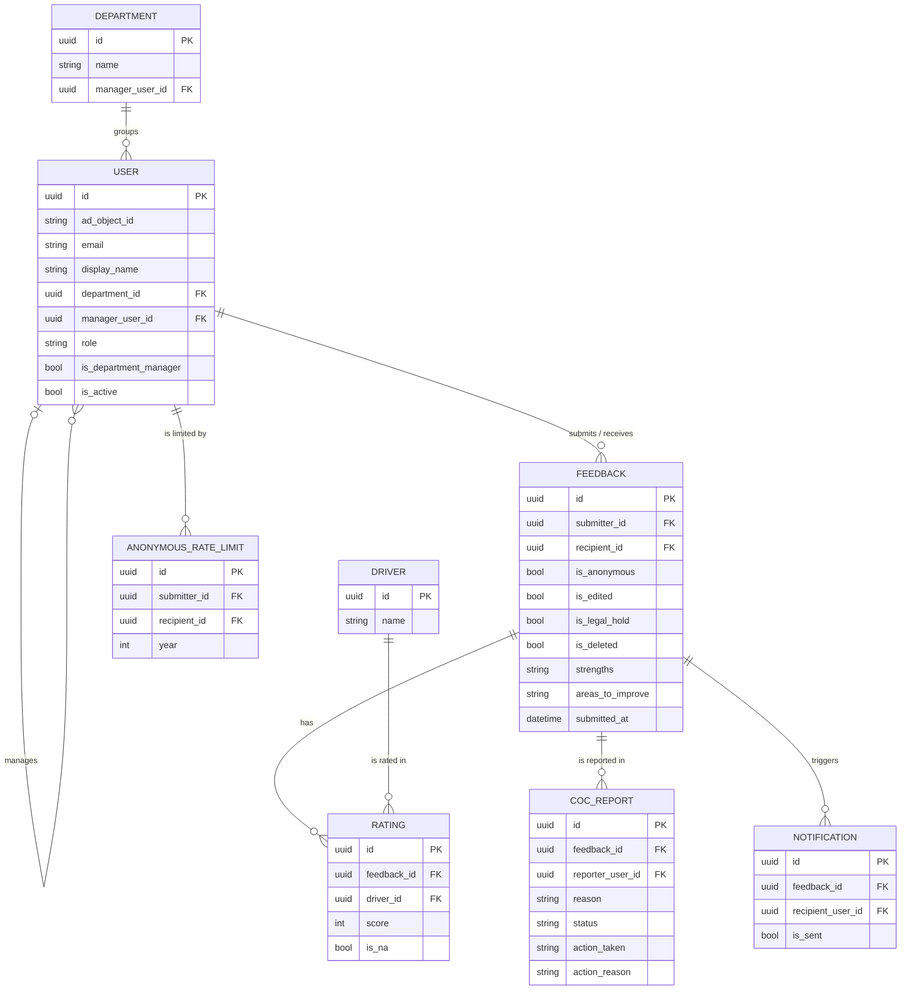

# Feedback Hub        

> Feedback Hub is an internal web portal where colleagues give each other structured, constructive feedback, by name or anonymously, so that feedback becomes a regular habit instead of something that only happens once a year.

> [!NOTE]
> **Feedback Hub is an internal company tool.**
> It depends on a Microsoft Entra ID tenant (sign-in, user sync, e-mail) and is not a ready-to-run public application. The setup steps below describe what is needed to run it in your own environment.

- Getting Started
  * [About the Project](#about-the-project)
  * [Features](#features)
  * [Tech Stack](#tech-stack)
  * [Data Model](#data-model)
- Running Feedback Hub
  * [Prerequisites](#prerequisites)
  * [Configuration](#configuration)
  * [Database](#database)
  * [Deploying on Windows Server (IIS)](#deploying-on-windows-server-iis)
- [Develop](#develop)
  * [Setup](#setup)
  * [Run](#run)
  * [API Overview](#api-overview)
  * [Project Structure](#project-structure)
- [Roadmap](#roadmap)
- [FAQ](#faq)

## About the Project

In many companies feedback is either part of the annual review or it does not happen at all. Critical points are often left unsaid, and positive feedback is rarely written down.

Feedback Hub gives employees one place to give and receive feedback. Every feedback follows the same structure, with four rated drivers and two free-text fields, so it stays comparable and focused on behaviour instead of personality. Employees can choose to give feedback anonymously. Managers see how their team is doing, and administrators moderate reports against the code of conduct.

Everyone signs in with their existing company Microsoft account. Users, roles and reporting lines are synced from Entra ID every day, so nobody has to maintain them by hand.

## Features

**Structured feedback**: rate a colleague on four drivers, **Impact / Results**, **Ownership / Reliability**, **Collaboration / Social** and **Growth / Learning**, on a scale from 1 to 5. Every level has a short description. Add written **strengths** and **areas to improve**.

**Named or anonymous**: choose whether the recipient sees your name. For anonymous feedback, the recipient and their manager see neither the sender nor the exact time, only the date.

**Inbox**: read all feedback you have received, with your average score per driver.

**History**: review the feedback you have sent. Each feedback can be edited once, within 5 minutes of sending it.

**Team view for managers**: managers see their direct reports, team averages per driver and each team member's received feedback. The team is based on the `manager` attribute in Entra ID.

**Code of conduct reports**: recipients can report a feedback that breaks the code of conduct. The report goes to a moderation queue, and a notification e-mail is sent to the configured code of conduct mailbox.

**Moderation**: administrators review reports and decide to dismiss them, keep the feedback with a note visible to both sides or remove it. HR intervention and escalation can be recorded for each case.

**Admin dashboard**: key figures, activity over the last 6 months (named vs. anonymous), average scores per driver, feedback count per department and the retention / legal hold status.

**User management and AD sync**: users, roles (`user`, `manager`, `admin`) and reporting lines are synced daily from Entra ID. Admins can deactivate and reactivate accounts, start a sync manually and view the last 10 sync runs.

**E-mail notifications**: recipients are notified by e-mail through Microsoft Graph when they receive new feedback. The e-mail contains only a link to the portal, never the feedback itself.

**German and English**: the whole interface is available in both languages.

### Feedback Rules

| Rule                                   | Value                                                       |
| -------------------------------------- | ----------------------------------------------------------- |
| Rated drivers                          | at least 2 of 4 (the others can be set to N/A)              |
| Written text                           | at least one of the two fields with 200 or more characters  |
| Code of conduct                        | must be confirmed before sending                            |
| Named feedback to the same person      | once every 90 days                                          |
| Anonymous feedback to the same person  | once per calendar year                                      |
| Editing                                | once, within 5 minutes after sending                        |
| Reporting                              | only by the recipient, once per feedback                    |
| Feedback to yourself                   | not allowed                                                 |

## Tech Stack

| Layer          | Technology                                                       |
| -------------- | ---------------------------------------------------------------- |
| Frontend       | HTML, vanilla JavaScript, Tailwind CSS, Chart.js, Webpack        |
| Backend        | ASP.NET Core Web API (.NET 10), Entity Framework Core            |
| Database       | PostgreSQL (Npgsql)                                              |
| Authentication | Microsoft Entra ID (MSAL.js in the browser, JWT in the API)      |
| Integrations   | Microsoft Graph (user and group sync, e-mail)                    |
| Hosting        | Windows Server, IIS                                              |

## Data Model

Every user belongs to one department and can have a manager, which is another user. A feedback goes from one user (submitter) to another (recipient) and holds one rating per driver.



Removed feedback is soft-deleted (`is_deleted`) and no longer appears in inboxes, histories or averages.

## Prerequisites

- A **PostgreSQL** database
- A **Microsoft Entra ID** tenant with:
  - an app registration for the portal that exposes the scope `access_as_user` and has the portal URL as SPA redirect URI
  - Microsoft Graph **application** permissions with admin consent: `Mail.Send` (notification e-mails), `GroupMember.Read.All` and `User.Read.All` (AD sync)
  - a certificate for the Graph client, installed in the `LocalMachine\My` certificate store of the server
  - a security group for all portal users (`G_FeedbackHub`) and one for administrators (`G_FeedbackHub_Admin`)
  - a mailbox that sends the notification e-mails
- A **Windows Server** with IIS and the ASP.NET Core Hosting Bundle for .NET 10
- **.NET 10 SDK**, **Node.js** and **Git** on the server for building

## Configuration

The backend reads its settings from `backend/feedbackhub/feedbackhub/appsettings.json`. The file contains secrets and is **gitignored**, so it has to be created on every machine. Minimal structure:

```jsonc
{
  "ConnectionStrings": {
    "DefaultConnection": "Host=localhost;Database=feedbackhub;Username=<user>;Password=<password>"
  },
  "AzureAd": {                                   // validates the JWT sent by the frontend
    "Instance": "https://login.microsoftonline.com/",
    "TenantId": "<tenant-id>",
    "ClientId": "<app-client-id>"
  },
  "Graph": {                                     // used for sending e-mails
    "TenantId": "<tenant-id>",
    "ClientId": "<app-client-id>",
    "CertificateThumbprint": "<certificate-thumbprint>"
  },
  "Cors": {
    "AllowedOrigins": [ "https://<your-host>" ]
  },
  "App": {
    "PortalUrl": "https://<your-host>",          // link in notification e-mails
    "SenderMailbox": "<sender@your-domain>",
    "CocReportMailbox": "<coc-reports@your-domain>"
  },
  "AdSync": {
    "Enabled": true,
    "RunAtHour": 3,                              // daily run, server local time
    "ClientSecret": "<client-secret>",
    "UserGroupId": "<object-id-of-G_FeedbackHub>",
    "AdminGroupId": "<object-id-of-G_FeedbackHub_Admin>"
  },
  "Recipients": {
    "ExcludedDisplayNamePatterns": [ "ADMA" ]    // accounts hidden from the recipient list
  }
}
```

The frontend has its Entra ID settings (client ID, tenant, redirect URI) in `frontend/js/auth.js`.

> [!TIP]
> The rules of the AD sync (scope, roles, deactivation, safety checks) are described in detail in [docs/ad-sync.md](docs/ad-sync.md) (German).

## Database

The project does **not** use Entity Framework migrations. Schema changes are versioned as SQL scripts in [`db/`](db/) and have to be run **manually** (pgAdmin or `psql`) against the database **before** the new version of the application starts. The scripts are idempotent and can be run more than once.

```bash
psql -h <host> -U <user> -d feedbackhub -f db/2026-07-23_add_users_manager_user_id.sql
```

> [!IMPORTANT]
> The initial database schema and the seed data for the four drivers are not part of the repository yet. Only the incremental scripts are versioned in `db/`.

## Deploying on Windows Server (IIS)

Production runs as an ASP.NET Core application in IIS. The backend also serves the built frontend from `wwwroot`, so frontend and API share one host and no separate web server is needed.

The script [`update.ps1`](update.ps1) handles the complete update on the server:

1. pulls the latest code into the source folder
2. installs the frontend dependencies and builds the frontend
3. builds `wwwroot` from the frontend build
4. takes the app offline with `app_offline.htm`, so IIS releases its file locks
5. backs up the server's `appsettings.json`, runs `dotnet publish` and restores the settings
6. brings the app back online and sends a warm-up request

```powershell
# on the server, inside the source checkout
.\update.ps1
```

> [!CAUTION]
> The paths (`C:\Apps\feedbackhub-src`, `C:\Apps\feedbackhub`) and the warm-up URL are hardcoded at the top of `update.ps1`. Adjust them before running the script on a different server. Run any new scripts from `db/` **before** the update.

If `dotnet publish` fails, the app stays offline. Fix the error and delete `app_offline.htm` in the publish folder manually.

## Develop

### Setup

```bash
# .NET 10 SDK, Node.js and a PostgreSQL database are required

git clone https://github.com/C3PHEI/feedback-portal.git
cd feedback-portal

# install frontend dependencies
cd frontend && npm install

# restore backend dependencies
cd ../backend/feedbackhub/feedbackhub && dotnet restore
```

Then create `appsettings.json` as described in [Configuration](#configuration).

> [!NOTE]
> The backend loads the Graph certificate from the Windows certificate store (`LocalMachine\My`) at startup and stops if it cannot find it. Local development therefore needs Windows with the certificate installed.

### Run

Run each command from the repository root, backend and frontend in separate terminals.

```bash
# start the backend (http://localhost:5185)
cd backend/feedbackhub/feedbackhub && dotnet run --launch-profile http

# start the frontend dev server (http://localhost:5000)
cd frontend && npm start

# build the frontend for production (output in frontend/dist)
cd frontend && npm run build
```

In development mode the API reference is available at `http://localhost:5185/scalar` and the OpenAPI document at `http://localhost:5185/openapi/v1.json`. The health check `GET /api/health` reports whether the database is reachable.

> [!NOTE]
> `frontend/js/auth.js` (MSAL redirect URI) and `frontend/js/api.js` (`BASE_URL`) point to production by default. For local development, point them to your local setup and register the local redirect URI in the app registration.

### API Overview

All endpoints except `/api/health` require a valid Entra ID token. Endpoints under `/api/admin` are restricted to administrators, and `/api/departments/my-team` to managers.

| Area          | Endpoints                                                                                     |
| ------------- | --------------------------------------------------------------------------------------------- |
| Profile       | `GET /api/me`                                                                                 |
| Recipients    | `GET /api/users/recipients`                                                                   |
| Feedback      | `POST /api/feedback`, `GET /api/feedback/{id}`, `PUT /api/feedback/{id}`, `POST /api/feedback/{id}/report` |
| Inbox         | `GET /api/feedback/inbox`, `GET /api/feedback/inbox/averages`                                 |
| History       | `GET /api/feedback/history`, `GET /api/feedback/can-submit-anonymous/{recipientId}`           |
| Team          | `GET /api/departments`, `GET /api/departments/my-team`, `.../my-team/averages`, `.../my-team/{userId}/feedbacks` |
| Dashboard     | `GET /api/admin/stats`, `.../charts/activity`, `.../charts/visibility`, `.../driver-averages`, `.../departments/stats`, `.../retention-status` |
| Moderation    | `GET /api/admin/reports`, `.../stats`, `.../{id}`, `PATCH .../{id}/status`, `POST .../{id}/action` |
| Users         | `GET /api/admin/users`, `PATCH .../{id}/role`, `PATCH .../{id}/department`, `POST .../{id}/deactivate`, `POST .../{id}/activate` |
| AD sync       | `POST /api/admin/sync/run`, `GET /api/admin/sync/status`, `GET /api/admin/sync/logs`          |
| Health        | `GET /api/health`                                                                             |

### Project Structure

```
feedback-portal/
├── frontend/                  # Multi-page UI (HTML, vanilla JS, Tailwind CSS, Chart.js)
│   ├── index.html             # Inbox
│   ├── feedback.html          # Give feedback
│   ├── history.html           # Sent feedback
│   ├── department.html        # Team view for managers
│   ├── admin.html             # Dashboard, moderation, user management
│   ├── js/                    # Auth (MSAL), API client, i18n, page scripts
│   ├── css/
│   └── img/
├── backend/feedbackhub/       # ASP.NET Core Web API (.NET 10)
│   └── feedbackhub/
│       ├── Controllers/       # REST endpoints under /api
│       ├── Services/          # Business rules, AD sync, Graph e-mail
│       ├── Models/            # EF Core entities
│       ├── Dtos/              # Request and response types
│       ├── Data/              # DbContext
│       └── Assets/            # Logo used in notification e-mails
├── db/                        # Manual SQL migration scripts
├── docs/                      # Additional documentation (AD sync)
├── update.ps1                 # Build and deploy script for the IIS server
└── README.md
```

## Roadmap

**Current status**: the core features are implemented and the application is under active development.

**Version 1.0**

- [x] Feedback with four rated drivers and written strengths / areas to improve
- [x] Anonymous feedback with yearly limit and 90-day cooldown for named feedback
- [x] Inbox and history with a one-time edit window of 5 minutes
- [x] Team view for managers based on Entra ID reporting lines
- [x] Code of conduct reports and moderation
- [x] Admin dashboard and user management
- [x] Daily user and role sync from Entra ID
- [x] E-mail notifications through Microsoft Graph
- [x] German and English interface
- [ ] Initial database schema and seed data in `db/`
- [ ] Partial redaction of feedback text (the action can be selected in moderation, but the text is not changed yet)
- [ ] Automated enforcement of the retention policy, including legal hold handling
- [ ] Automated tests for backend and frontend

**Future ideas**

- [ ] Local development login without Entra ID (a `TestAuth` handler exists but is not registered in `Program.cs` yet)
- [ ] Configuration template (`appsettings.template.json`) in the repository
- [ ] Bundling Tailwind CSS at build time instead of loading it from the CDN

## FAQ

### Who can see who wrote an anonymous feedback?

Not the recipient, and not the recipient's manager. Both see the feedback with its date only, without name or time. Only when an anonymous feedback is **reported** can administrators see the sender in the moderation view, so they can investigate misuse such as repeated anonymous attacks.

### Why can't I send feedback to the same person again?

Named feedback to the same person is possible once every 90 days, anonymous feedback once per calendar year. This keeps feedback meaningful and prevents one person from being flooded. If a named feedback is removed by moderation, the 90-day cooldown for that person is lifted.

### Can I change a feedback after sending it?

Yes, once, within 5 minutes after sending. After that the feedback is locked. Your history shows which feedback you have edited.

### What happens when I report a feedback?

The report is added to the moderation queue, and an e-mail is sent to the code of conduct mailbox. An administrator then reviews it and either dismisses the report, keeps the feedback with a note or removes it. Each feedback can only be reported once.

### Why doesn't the notification e-mail contain the feedback?

To protect the content, and especially anonymous feedback, nothing but a link to the portal is sent by e-mail. The feedback can only be read after signing in.

### How are users, roles and teams managed?

Through Entra ID. A daily sync creates, updates and deactivates users based on the `G_FeedbackHub` group, makes members of `G_FeedbackHub_Admin` administrators and builds the teams from the `manager` attribute. Changes made in the portal can be overwritten by the next sync, so permanent changes belong in Entra ID. See [docs/ad-sync.md](docs/ad-sync.md) for the full rules.

### Can I run it in Docker?

Not at the moment. The backend contains a `Dockerfile`, but it loads its Graph certificate from the Windows certificate store, which is not available in a Linux container. The supported setup is IIS on Windows Server.

---

**Feedback Hub**, ˈfiːdbæk hʌb (n): the place where ~~"we should talk about that sometime"~~ honest, structured feedback actually gets written down.
